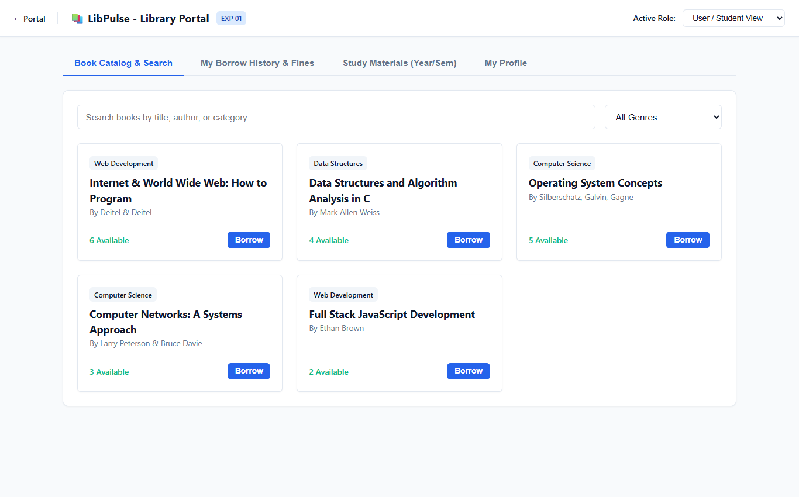
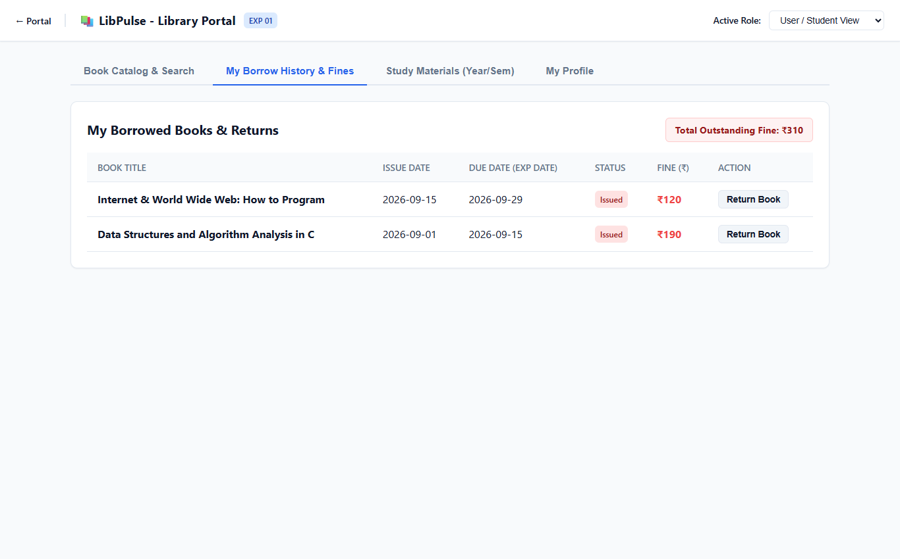
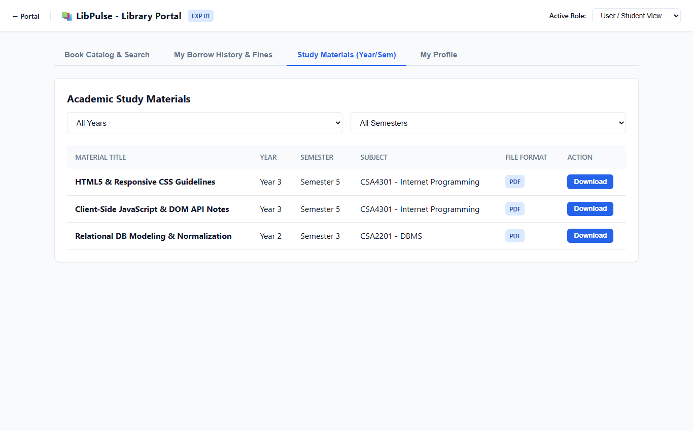
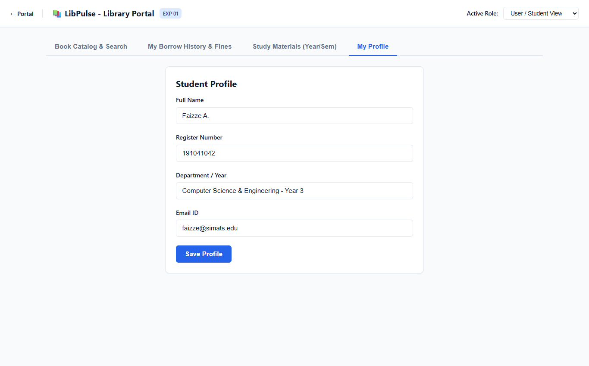
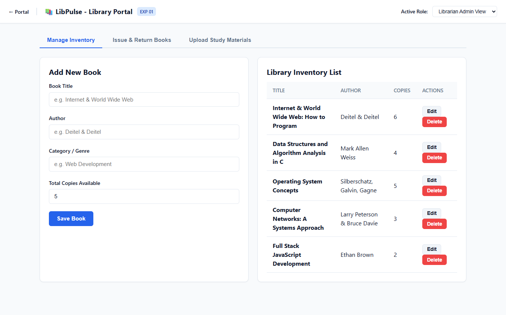
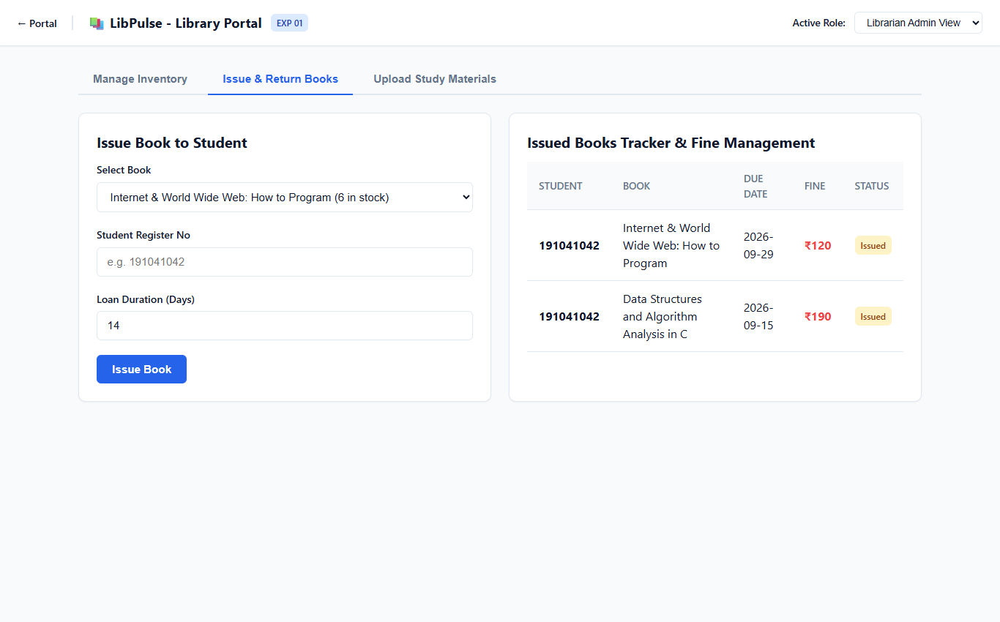
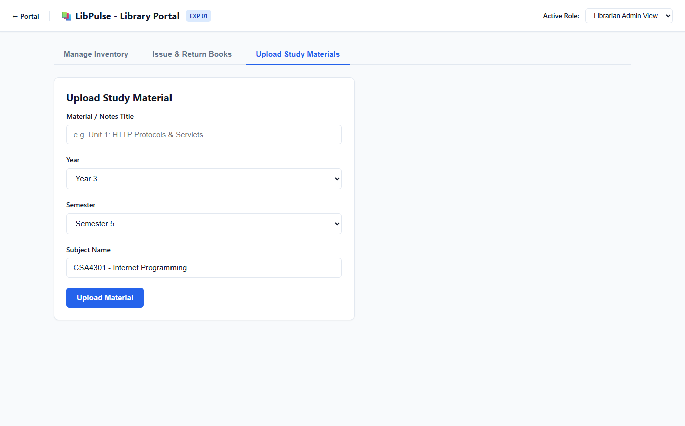

# Experiment 01: Local Library Management System

Output screenshots for all operational tabs and views (7 views in order).

| # | View Name | Screenshot Preview |
| :---: | :--- | :--- |
| 1 | **User Student View Book Catalog Search** |  |
| 2 | **User Student View My Borrow History Fines** |  |
| 3 | **User Student View Study Materials Yearsem** |  |
| 4 | **User Student View My Profile** |  |
| 5 | **Librarian Admin View Manage Inventory** |  |
| 6 | **Librarian Admin View Issue Return Books** |  |
| 7 | **Librarian Admin View Upload Study Materials** |  |
