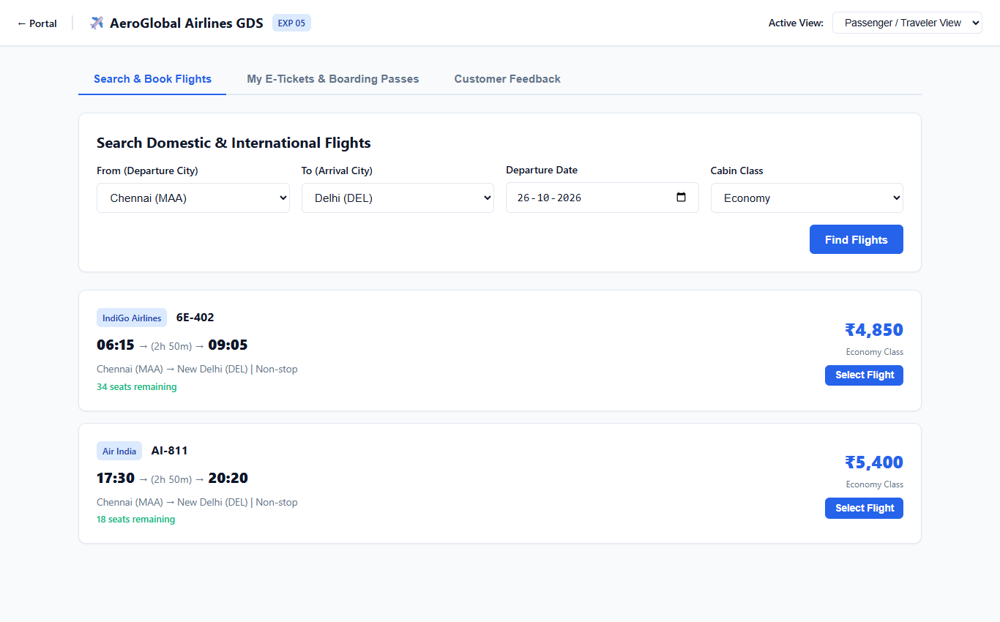
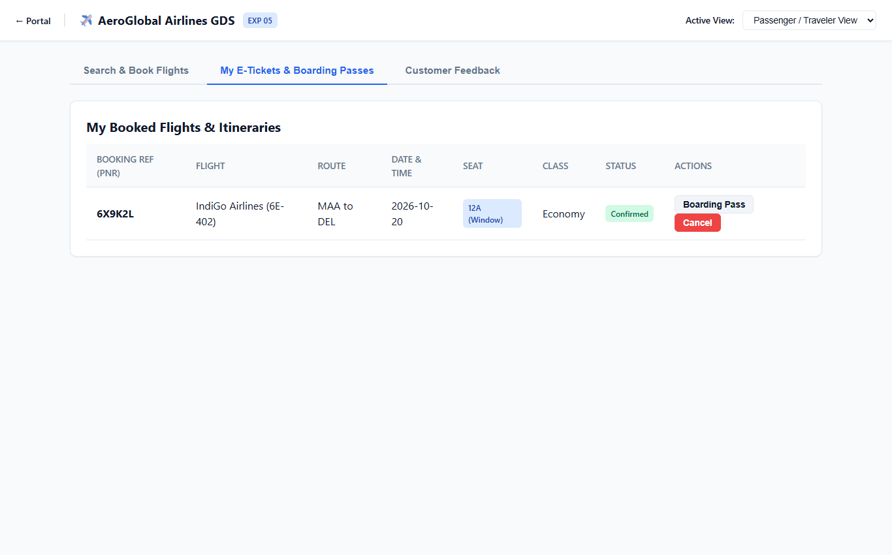
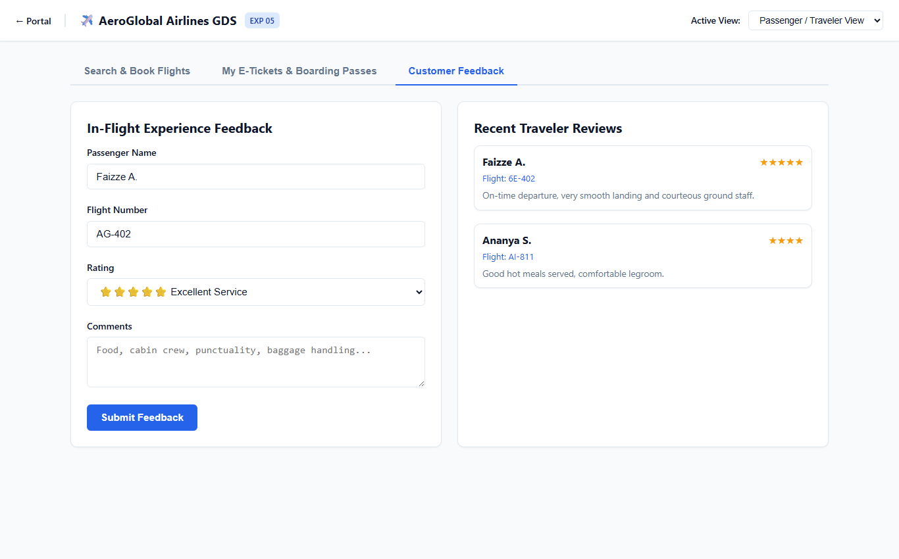
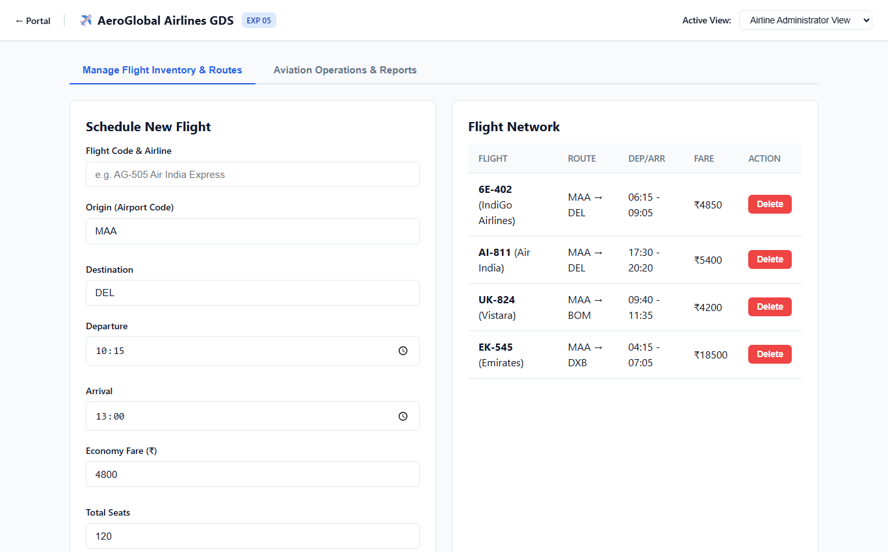
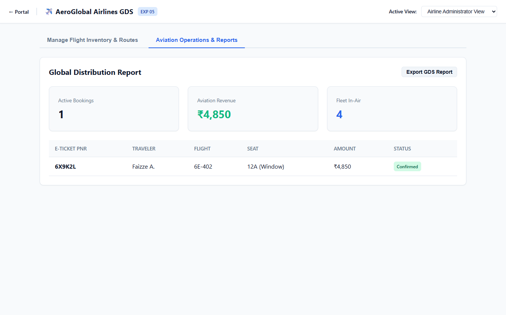

# Experiment 05: Online Flight Reservation System

Output screenshots for all operational tabs and views (5 views in order).

| # | View Name | Screenshot Preview |
| :---: | :--- | :--- |
| 1 | **Passenger Traveler View Search Book Flights** |  |
| 2 | **Passenger Traveler View My E Tickets Boarding Passes** |  |
| 3 | **Passenger Traveler View Customer Feedback** |  |
| 4 | **Airline Administrator View Manage Flight Inventory Routes** |  |
| 5 | **Airline Administrator View Aviation Operations Reports** |  |
