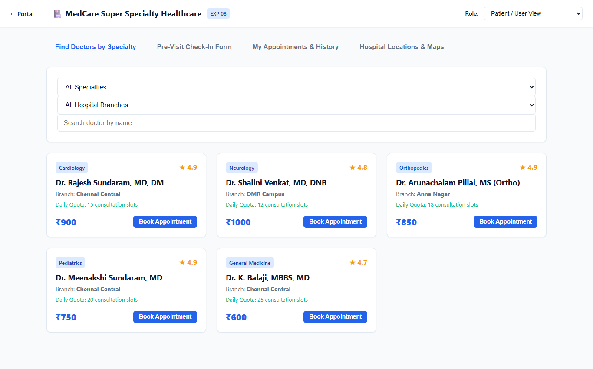
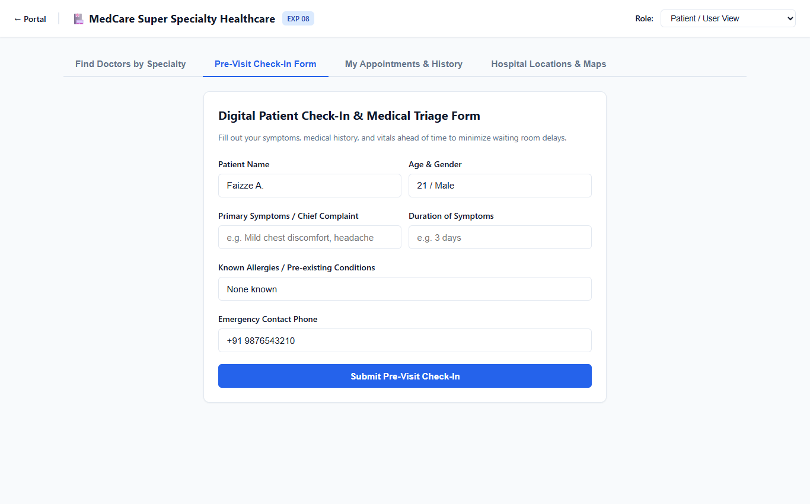
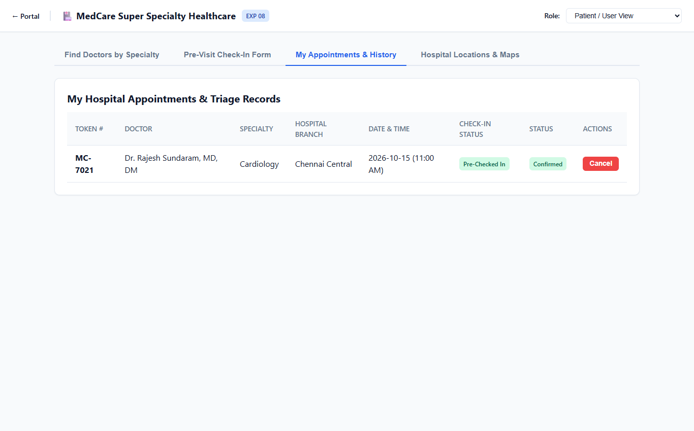
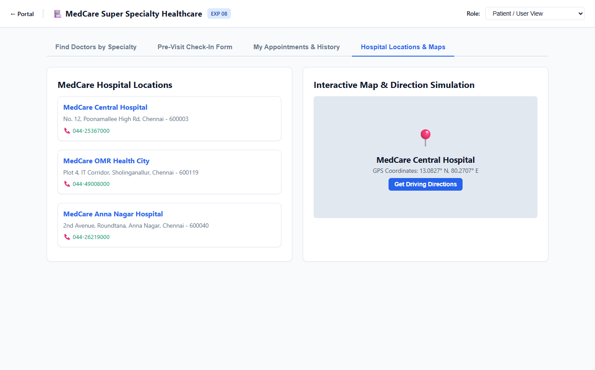
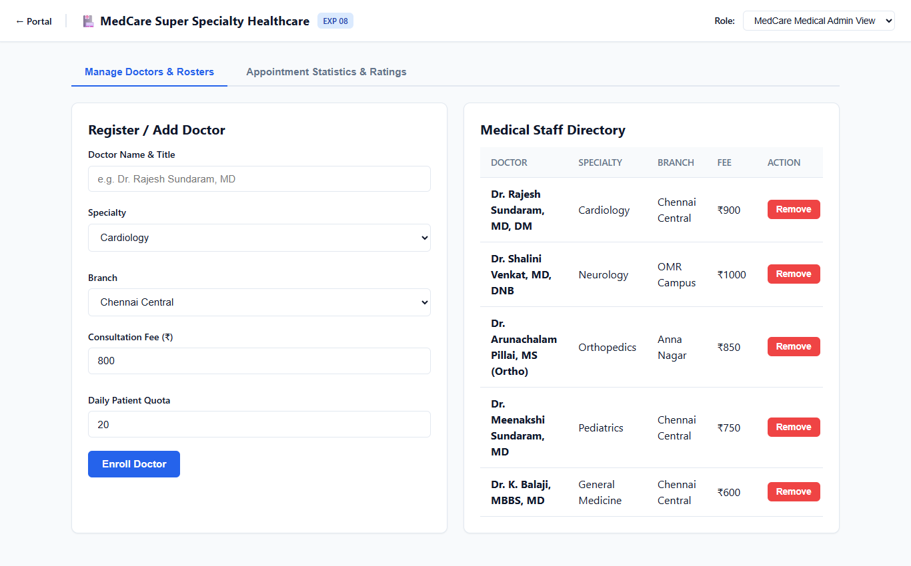
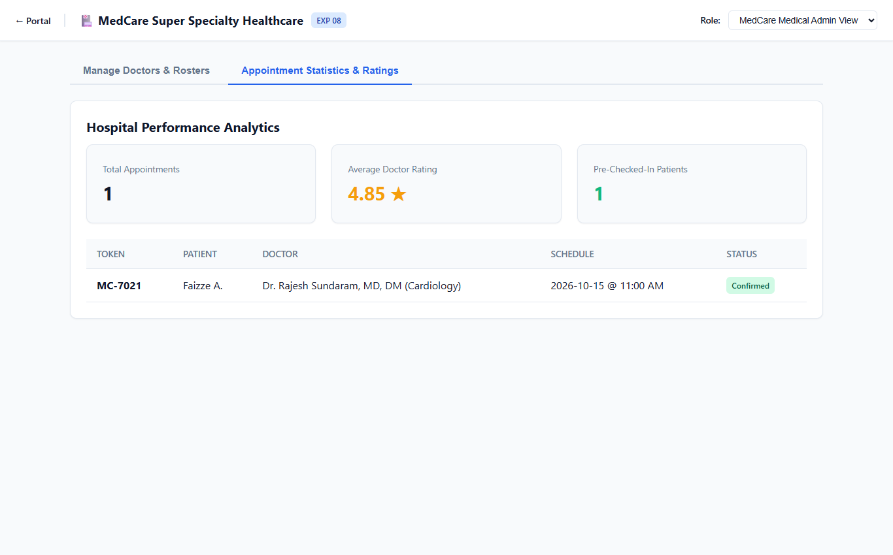

# Experiment 08: MedCare Hospital Online Appointment System

Output screenshots for all operational tabs and views (6 views in order).

| # | View Name | Screenshot Preview |
| :---: | :--- | :--- |
| 1 | **Patient User View Find Doctors By Specialty** |  |
| 2 | **Patient User View Pre Visit Check In Form** |  |
| 3 | **Patient User View My Appointments History** |  |
| 4 | **Patient User View Hospital Locations Maps** |  |
| 5 | **Medcare Medical Admin View Manage Doctors Rosters** |  |
| 6 | **Medcare Medical Admin View Appointment Statistics Ratings** |  |
