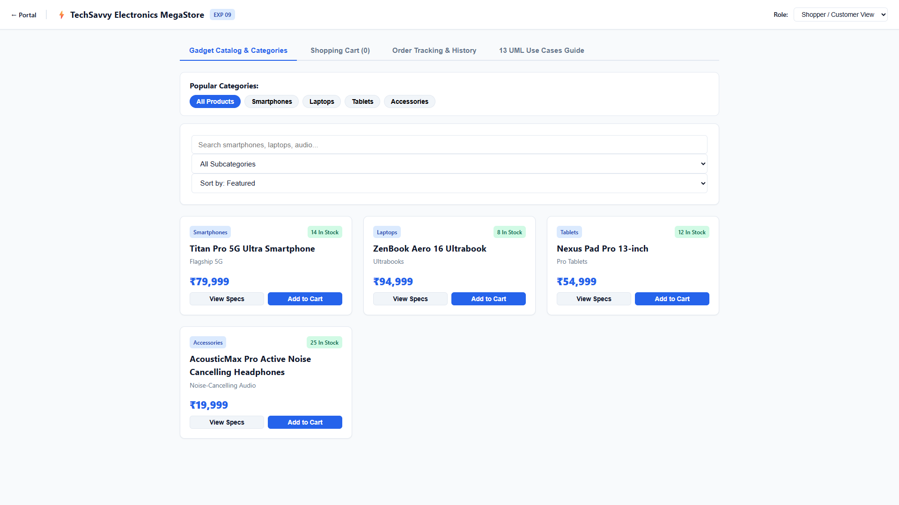
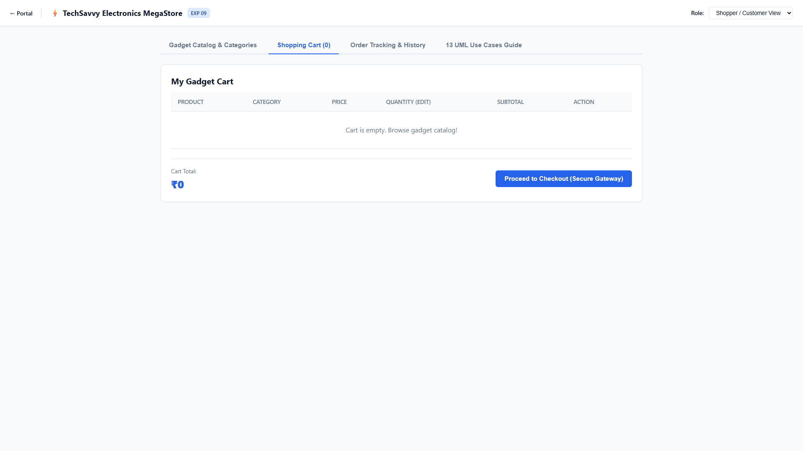
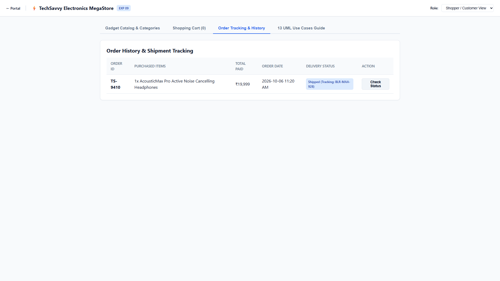
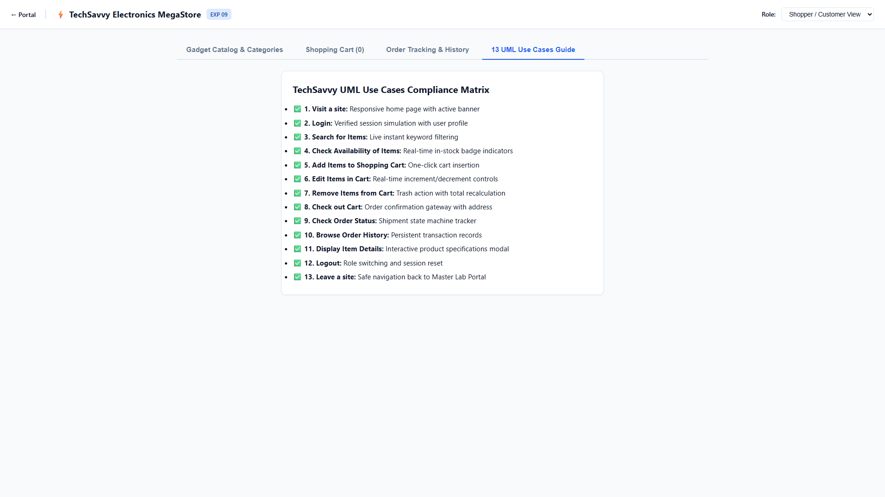
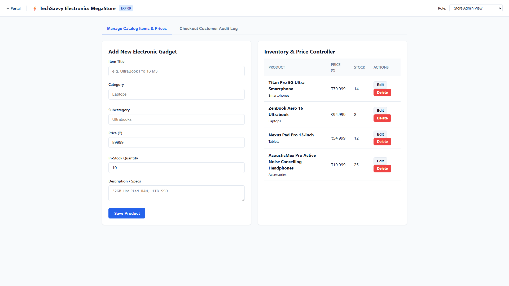
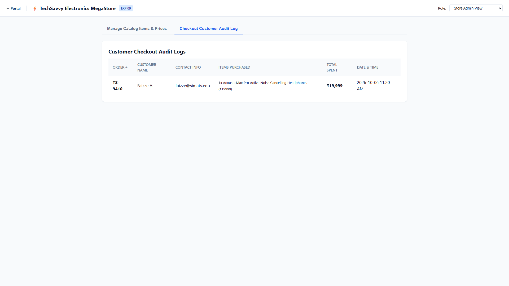

# Experiment 09: TechSavvy Electronics Shopping Platform

Output screenshots for all operational tabs and views (6 views in order).

| # | View Name | Screenshot Preview |
| :---: | :--- | :--- |
| 1 | **Shopper Customer View Gadget Catalog Categories** |  |
| 2 | **Shopper Customer View Shopping Cart 0** |  |
| 3 | **Shopper Customer View Order Tracking History** |  |
| 4 | **Shopper Customer View 13 Uml Use Cases Guide** |  |
| 5 | **Store Admin View Manage Catalog Items Prices** |  |
| 6 | **Store Admin View Checkout Customer Audit Log** |  |
