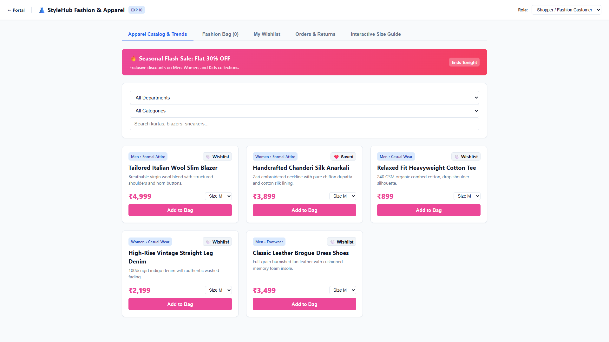
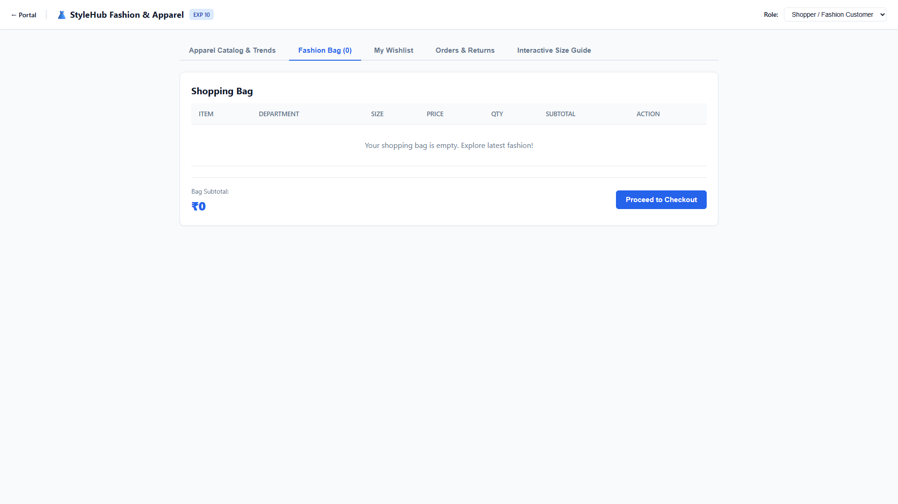
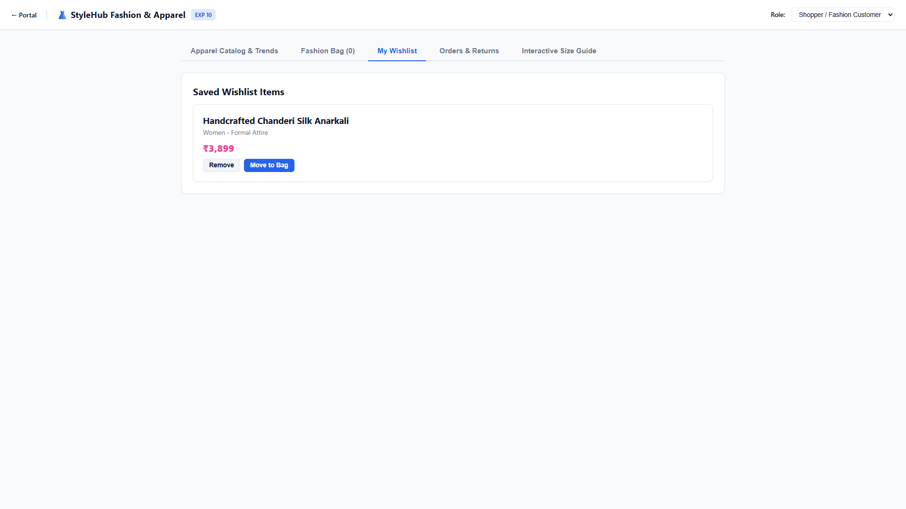
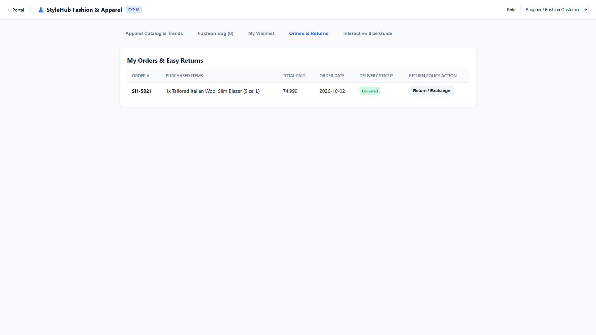
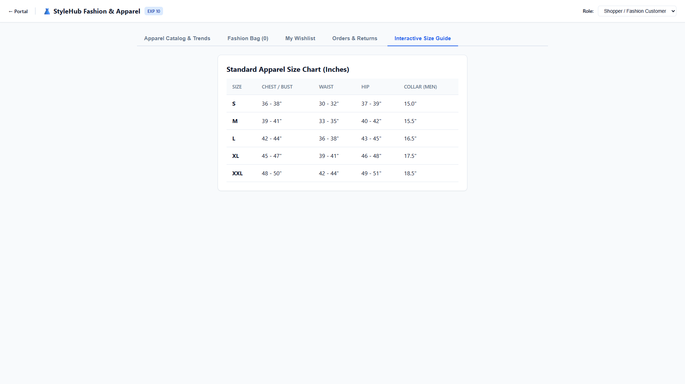
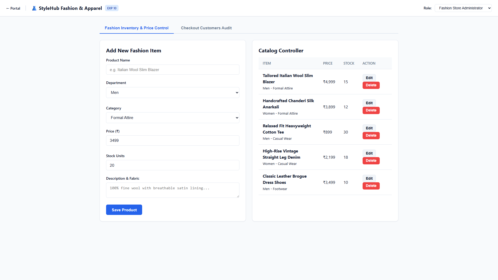
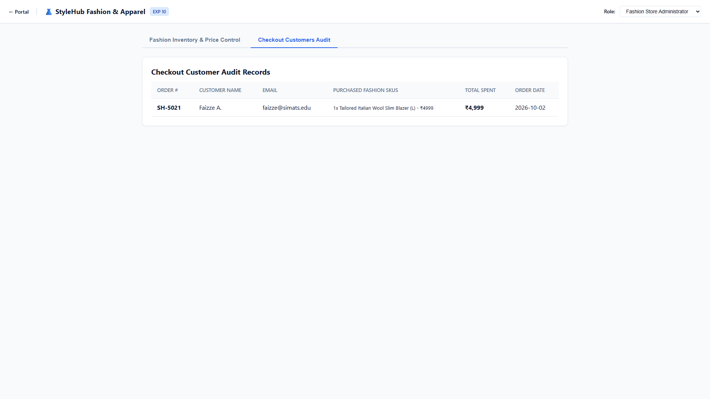

# Experiment 10: StyleHub Online Fashion Retailer

Output screenshots for all operational tabs and views (7 views in order).

| # | View Name | Screenshot Preview |
| :---: | :--- | :--- |
| 1 | **Shopper Fashion Customer Apparel Catalog Trends** |  |
| 2 | **Shopper Fashion Customer Fashion Bag 0** |  |
| 3 | **Shopper Fashion Customer My Wishlist** |  |
| 4 | **Shopper Fashion Customer Orders Returns** |  |
| 5 | **Shopper Fashion Customer Interactive Size Guide** |  |
| 6 | **Fashion Store Administrator Fashion Inventory Price Control** |  |
| 7 | **Fashion Store Administrator Checkout Customers Audit** |  |
