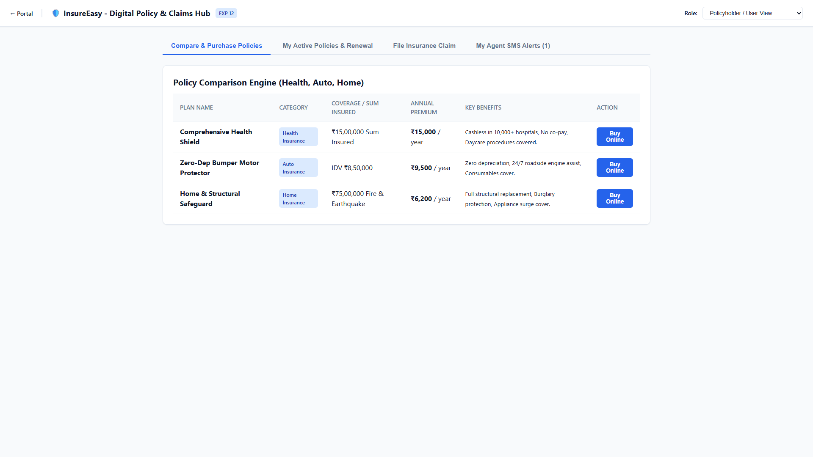
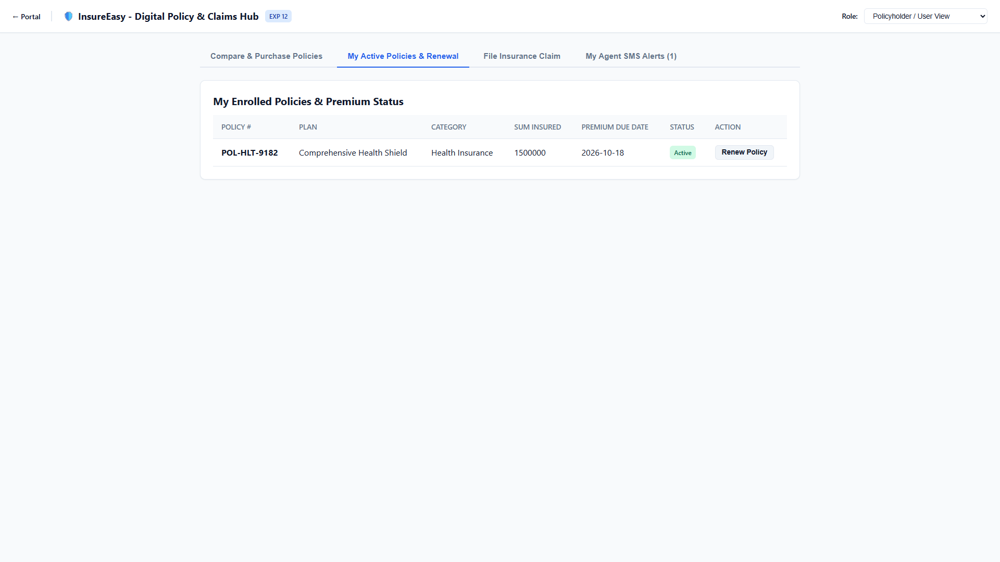
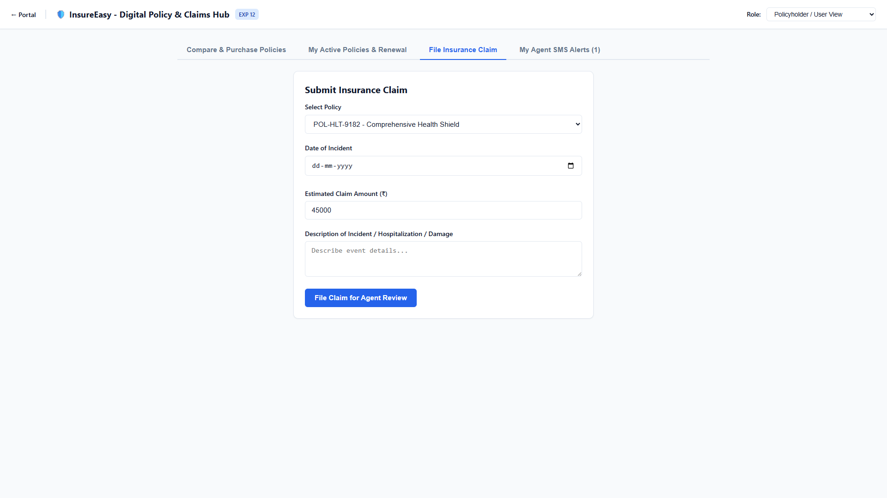
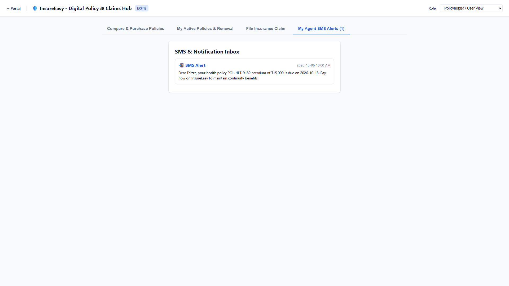
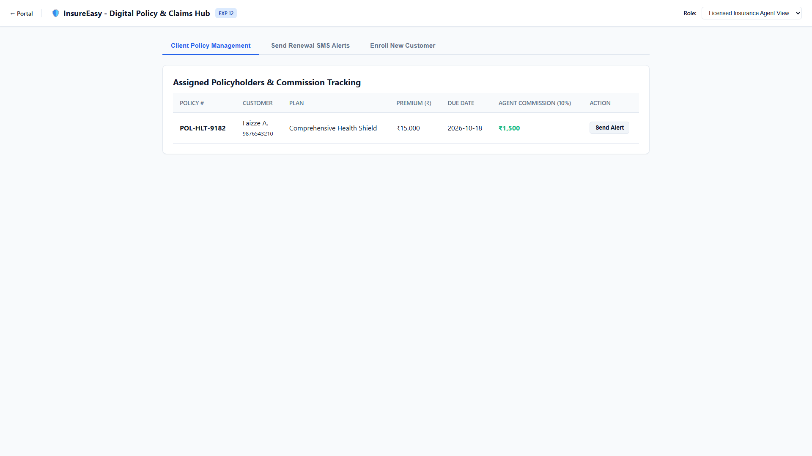
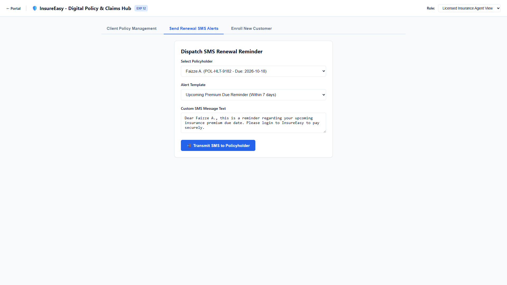
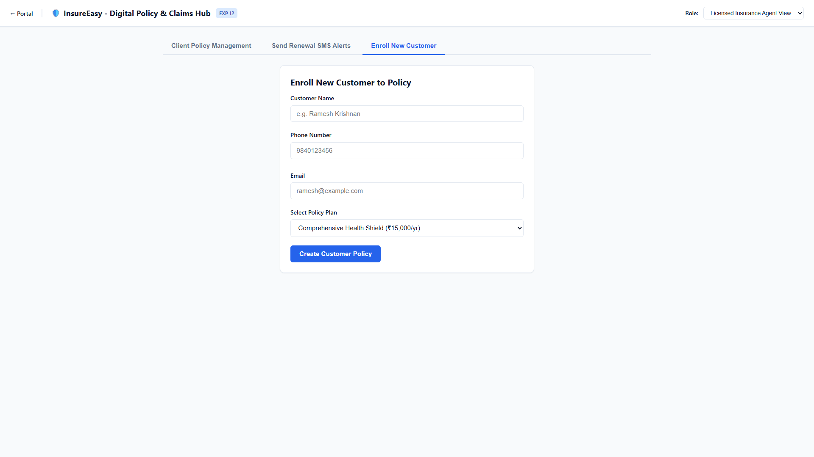
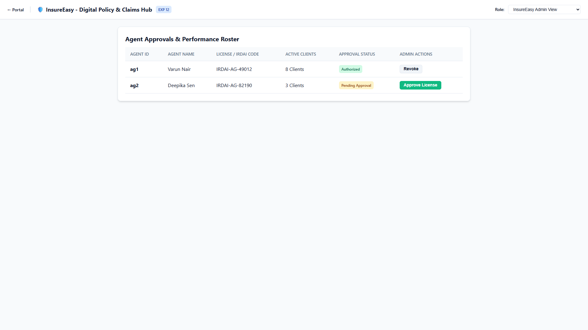

# Experiment 12: InsureEasy Online Insurance Management Platform

Output screenshots for all operational tabs and views (8 views in order).

| # | View Name | Screenshot Preview |
| :---: | :--- | :--- |
| 1 | **Policyholder User View Compare Purchase Policies** |  |
| 2 | **Policyholder User View My Active Policies Renewal** |  |
| 3 | **Policyholder User View File Insurance Claim** |  |
| 4 | **Policyholder User View My Agent Sms Alerts 1** |  |
| 5 | **Licensed Insurance Agent View Client Policy Management** |  |
| 6 | **Licensed Insurance Agent View Send Renewal Sms Alerts** |  |
| 7 | **Licensed Insurance Agent View Enroll New Customer** |  |
| 8 | **Insureeasy Admin View Overview** |  |
