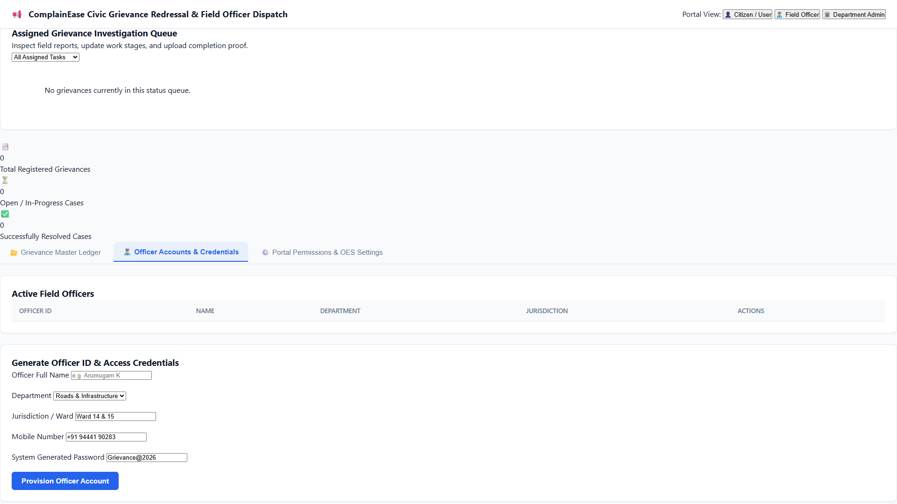
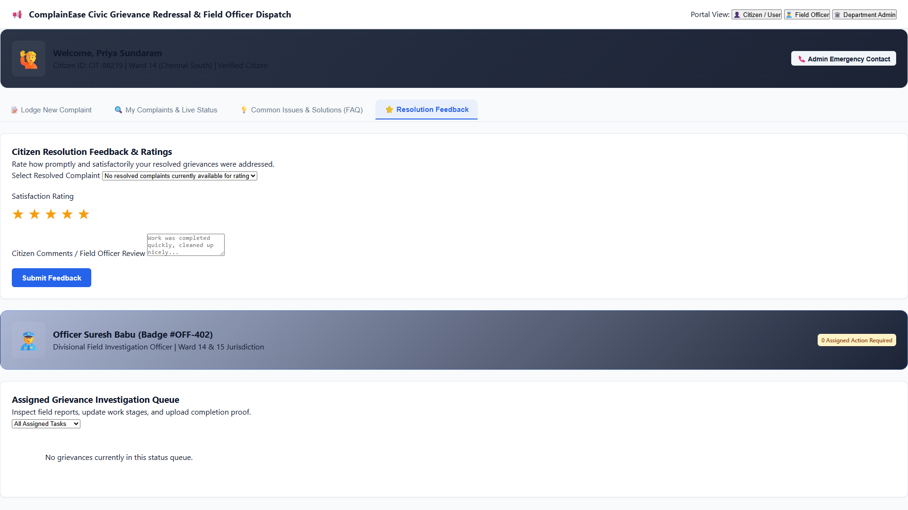
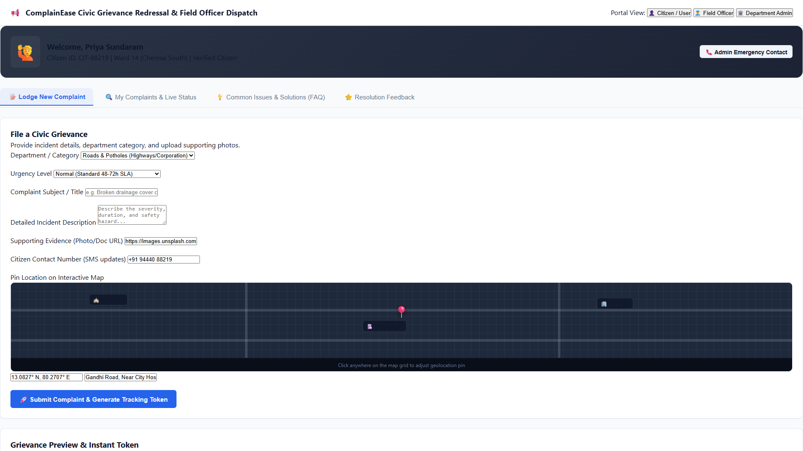
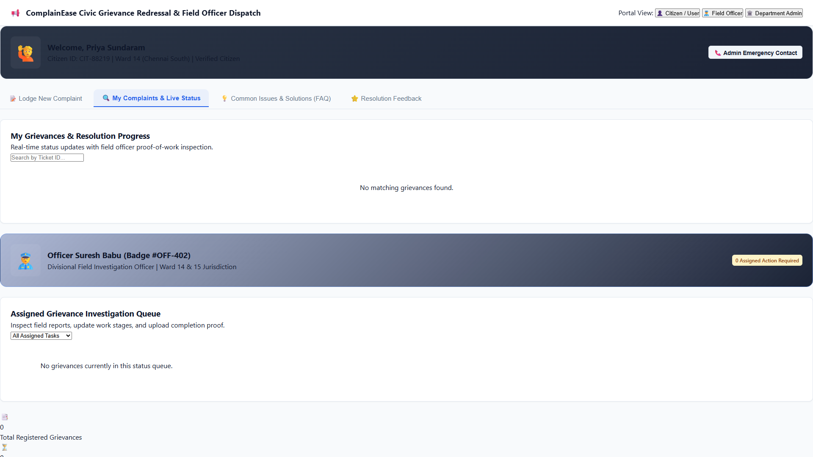
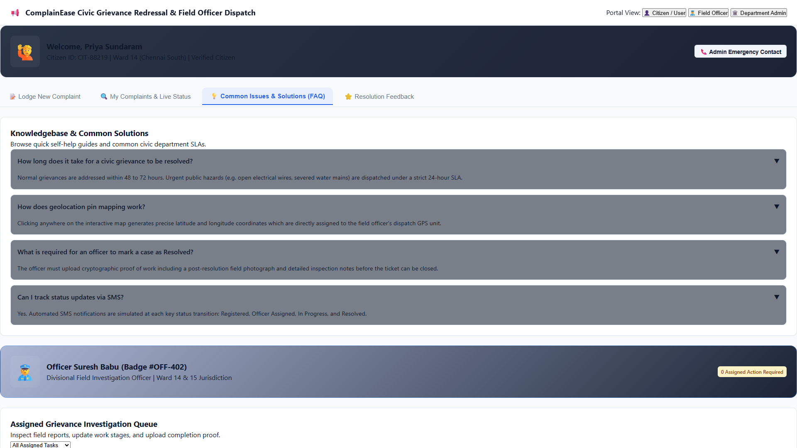
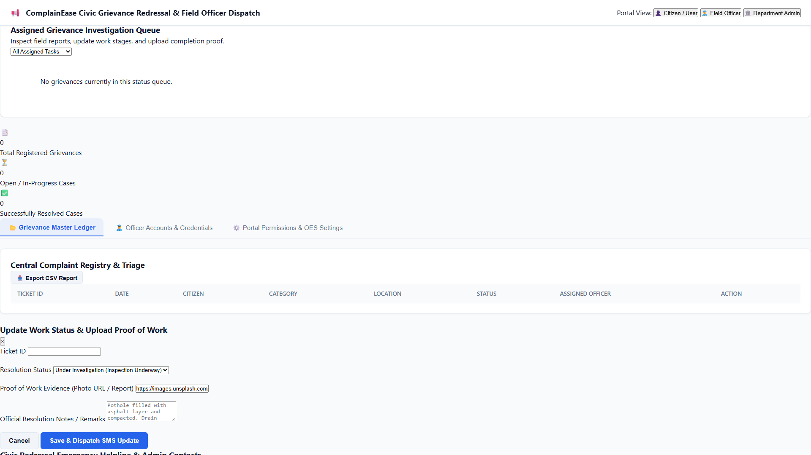
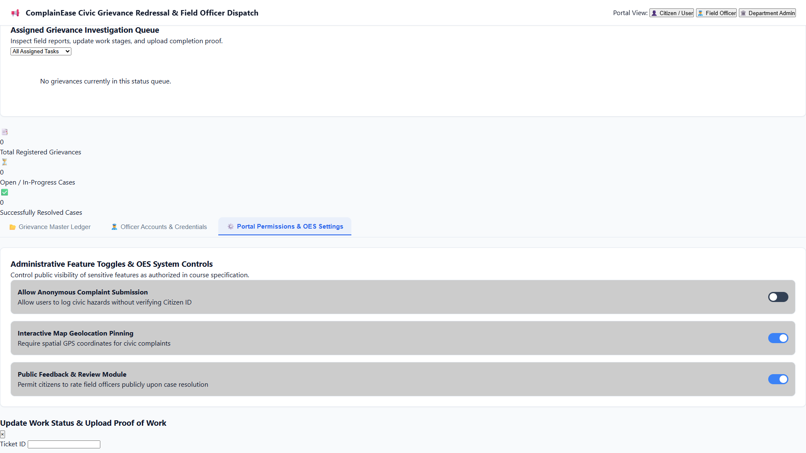

# Experiment 16: ComplainEase - Public Grievance Redressal & Resolution Platform

Output screenshots for all operational tabs and views (21 views in order).

| # | View Name | Screenshot Preview |
| :---: | :--- | :--- |
| 1 | **Citizen User Lodge New Complaint** |  |
| 2 | **Citizen User My Complaints Live Status** |  |
| 3 | **Citizen User Common Issues Solutions Faq** |  |
| 4 | **Citizen User Resolution Feedback** |  |
| 5 | **Citizen User Grievance Master Ledger** |  |
| 6 | **Citizen User Officer Accounts Credentials** |  |
| 7 | **Citizen User Portal Permissions Oes Settings** |  |
| 8 | **Field Officer Lodge New Complaint** |  |
| 9 | **Field Officer My Complaints Live Status** |  |
| 10 | **Field Officer Common Issues Solutions Faq** |  |
| 11 | **Field Officer Resolution Feedback** |  |
| 12 | **Field Officer Grievance Master Ledger** |  |
| 13 | **Field Officer Officer Accounts Credentials** |  |
| 14 | **Field Officer Portal Permissions Oes Settings** |  |
| 15 | **Department Admin Lodge New Complaint** |  |
| 16 | **Department Admin My Complaints Live Status** |  |
| 17 | **Department Admin Common Issues Solutions Faq** |  |
| 18 | **Department Admin Resolution Feedback** |  |
| 19 | **Department Admin Grievance Master Ledger** |  |
| 20 | **Department Admin Officer Accounts Credentials** |  |
| 21 | **Department Admin Portal Permissions Oes Settings** |  |
