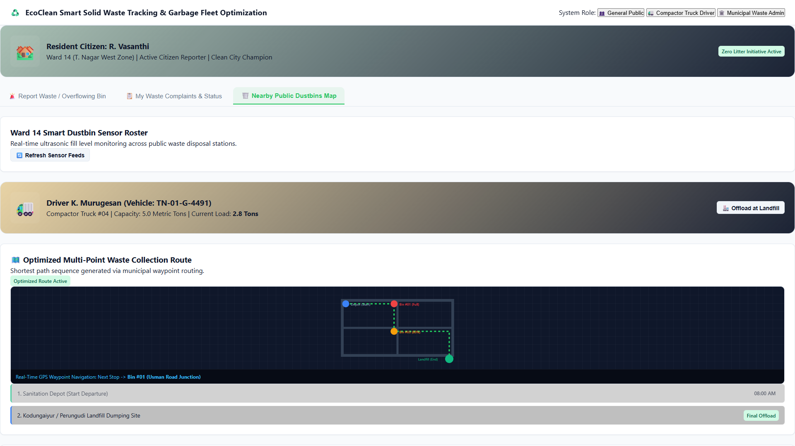
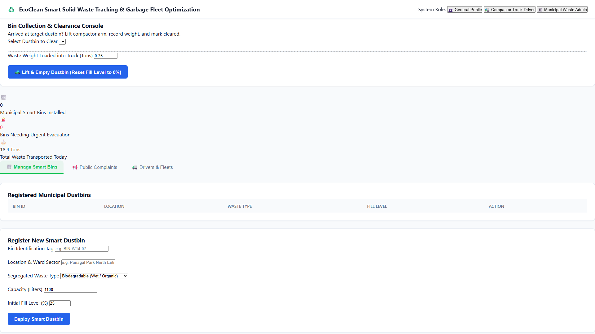
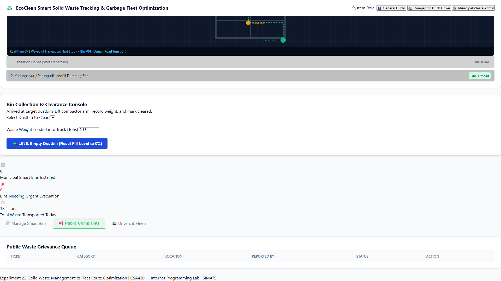
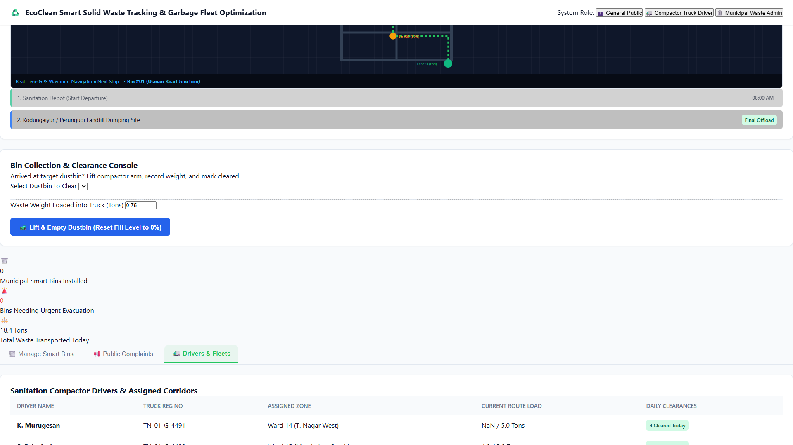
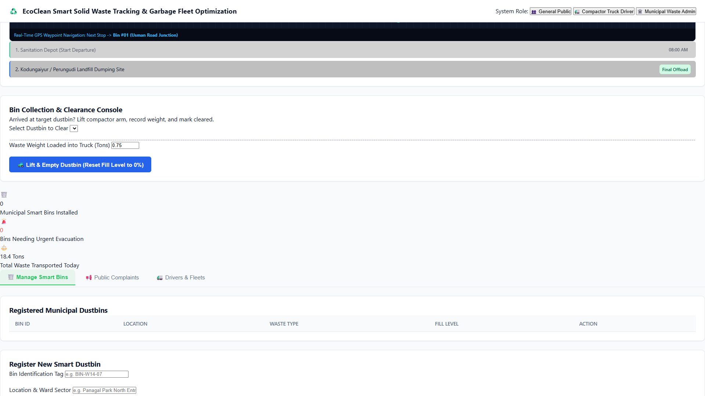
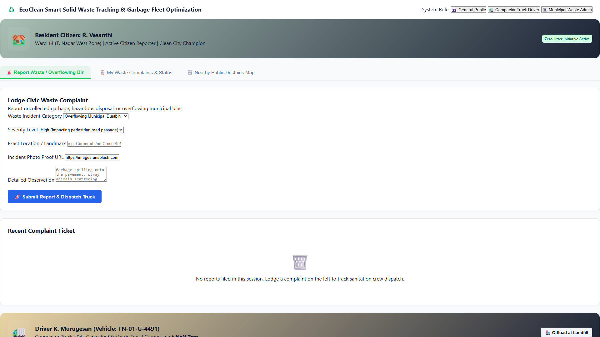
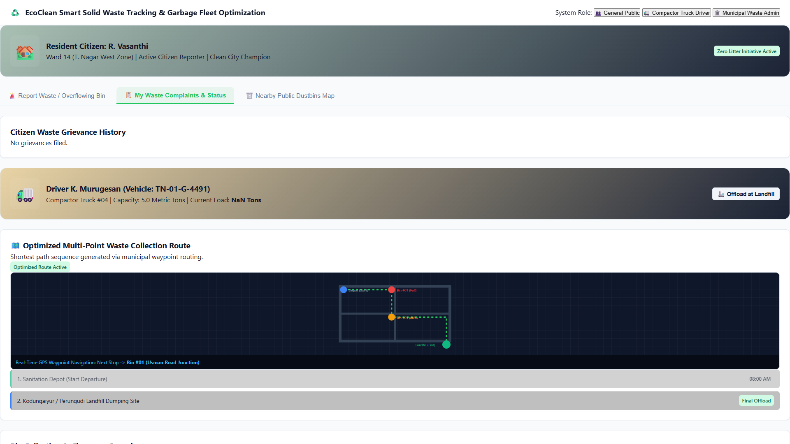
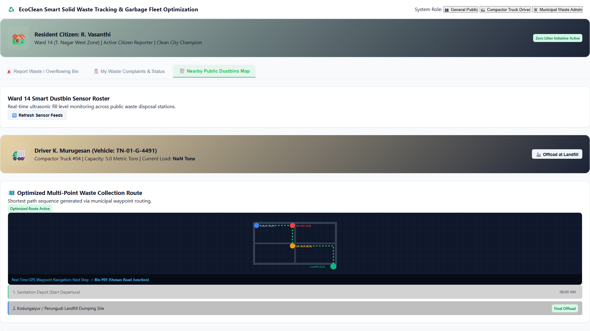

# Experiment 22: EcoClean - Smart Municipal Solid Waste Management & Route Optimization

Output screenshots for all operational tabs and views (18 views in order).

| # | View Name | Screenshot Preview |
| :---: | :--- | :--- |
| 1 | **General Public Report Waste Overflowing Bin** |  |
| 2 | **General Public My Waste Complaints Status** |  |
| 3 | **General Public Nearby Public Dustbins Map** |  |
| 4 | **General Public Manage Smart Bins** |  |
| 5 | **General Public Public Complaints** |  |
| 6 | **General Public Drivers Fleets** |  |
| 7 | **Compactor Truck Driver Report Waste Overflowing Bin** |  |
| 8 | **Compactor Truck Driver My Waste Complaints Status** |  |
| 9 | **Compactor Truck Driver Nearby Public Dustbins Map** |  |
| 10 | **Compactor Truck Driver Manage Smart Bins** |  |
| 11 | **Compactor Truck Driver Public Complaints** |  |
| 12 | **Compactor Truck Driver Drivers Fleets** |  |
| 13 | **Municipal Waste Admin Report Waste Overflowing Bin** |  |
| 14 | **Municipal Waste Admin My Waste Complaints Status** |  |
| 15 | **Municipal Waste Admin Nearby Public Dustbins Map** |  |
| 16 | **Municipal Waste Admin Manage Smart Bins** |  |
| 17 | **Municipal Waste Admin Public Complaints** |  |
| 18 | **Municipal Waste Admin Drivers Fleets** |  |
