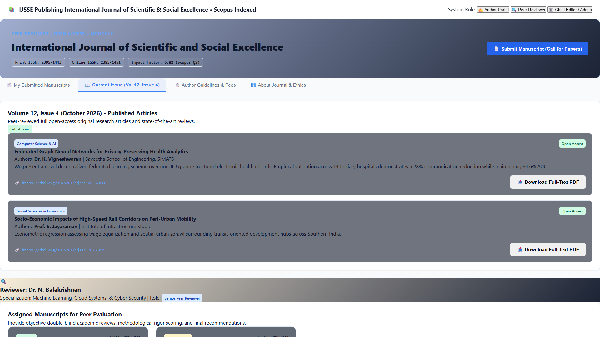
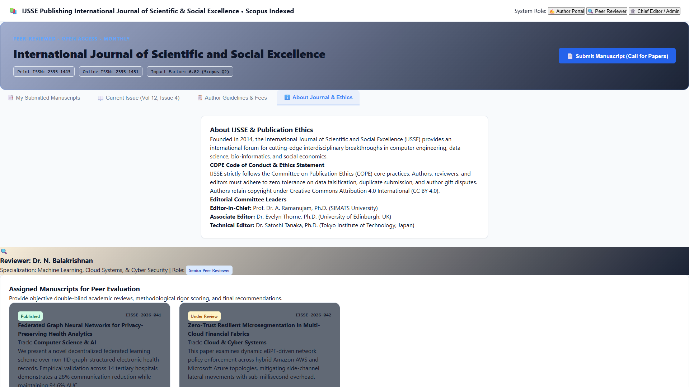
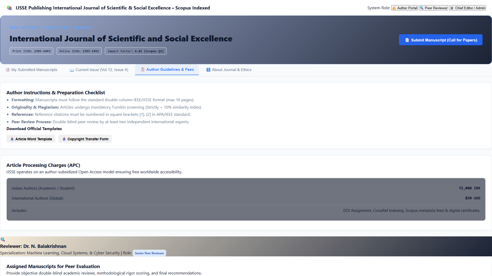
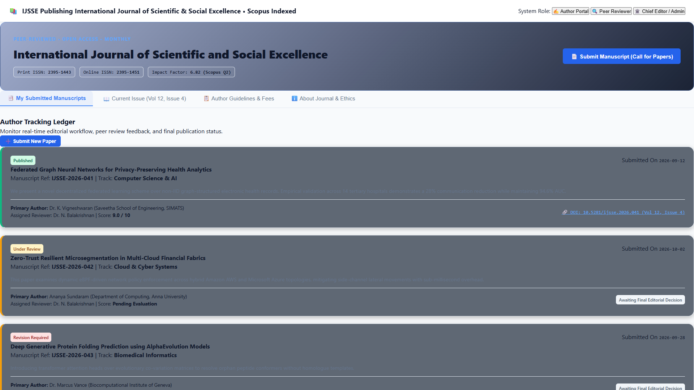

# Experiment 30: IJSSE - International Journal of Scientific and Social Excellence (Scopus-Indexed)

Output screenshots for all operational tabs and views (12 views in order).

| # | View Name | Screenshot Preview |
| :---: | :--- | :--- |
| 1 | **Author Portal My Submitted Manuscripts** |  |
| 2 | **Author Portal Current Issue Vol 12 Issue 4** |  |
| 3 | **Author Portal Author Guidelines Fees** |  |
| 4 | **Author Portal ℹ About Journal Ethics** |  |
| 5 | **Peer Reviewer My Submitted Manuscripts** |  |
| 6 | **Peer Reviewer Current Issue Vol 12 Issue 4** |  |
| 7 | **Peer Reviewer Author Guidelines Fees** |  |
| 8 | **Peer Reviewer ℹ About Journal Ethics** |  |
| 9 | **Chief Editor Admin My Submitted Manuscripts** |  |
| 10 | **Chief Editor Admin Current Issue Vol 12 Issue 4** |  |
| 11 | **Chief Editor Admin Author Guidelines Fees** |  |
| 12 | **Chief Editor Admin ℹ About Journal Ethics** |  |
