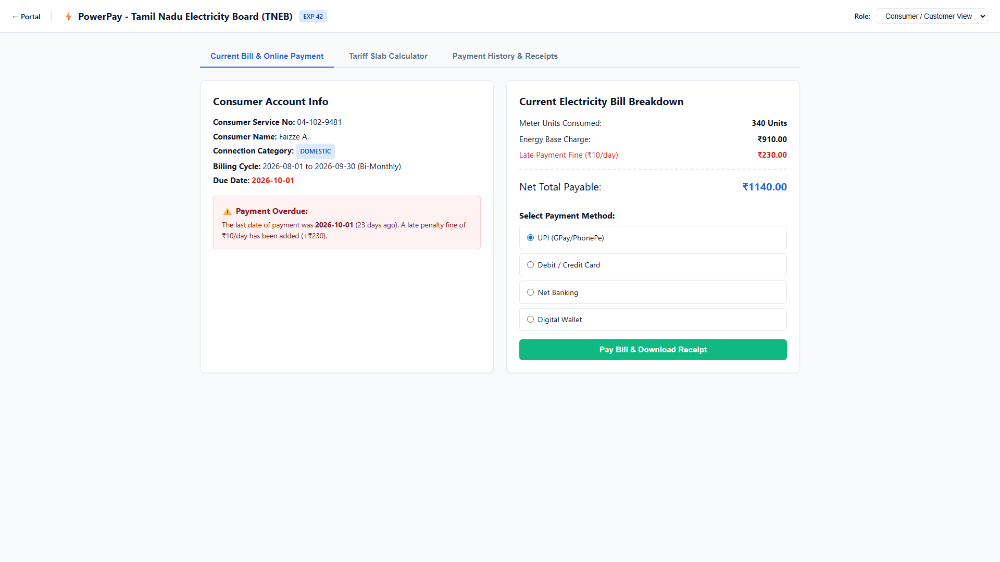
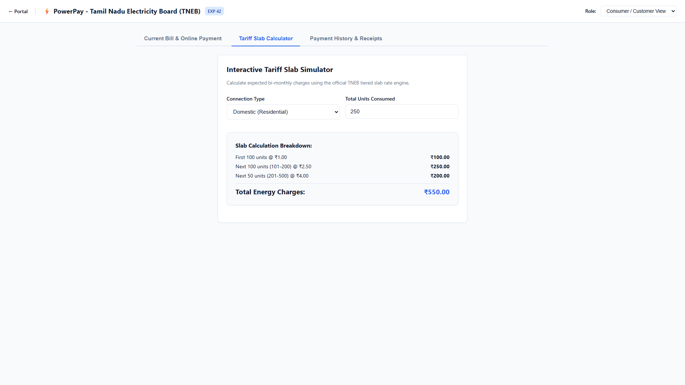
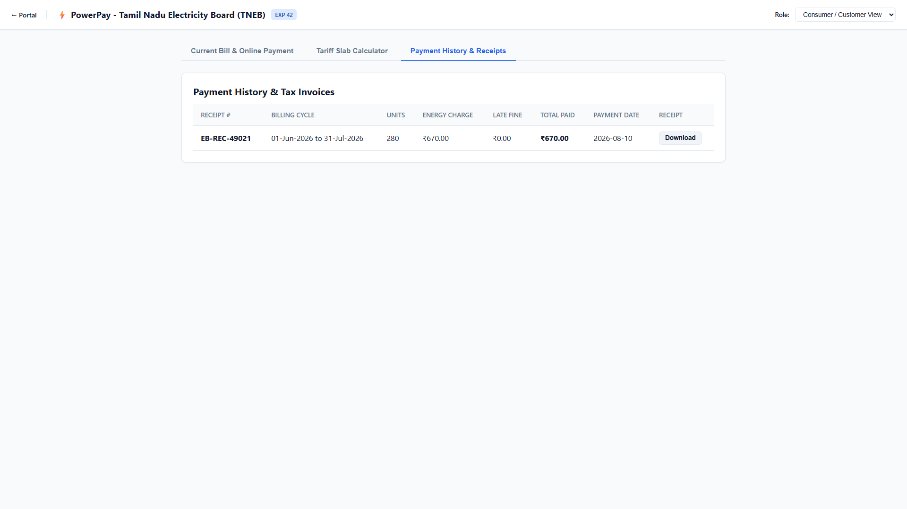
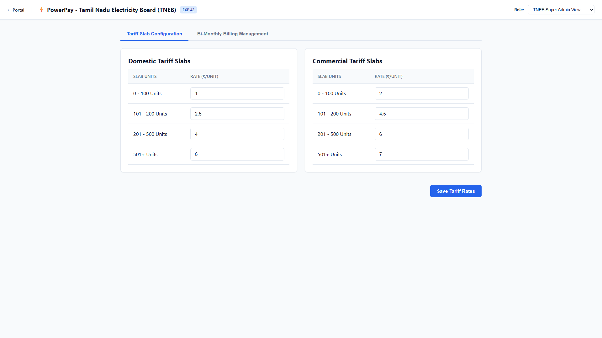
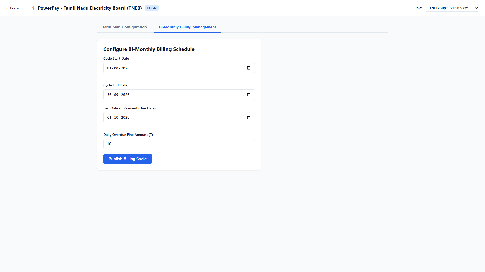

# Experiment 42: Online Electricity Bill Payment & Tariff Engine

Output screenshots for all operational tabs and views (5 views in order).

| # | View Name | Screenshot Preview |
| :---: | :--- | :--- |
| 1 | **Consumer Customer View Current Bill Online Payment** |  |
| 2 | **Consumer Customer View Tariff Slab Calculator** |  |
| 3 | **Consumer Customer View Payment History Receipts** |  |
| 4 | **Tneb Super Admin View Tariff Slab Configuration** |  |
| 5 | **Tneb Super Admin View Bi Monthly Billing Management** |  |
