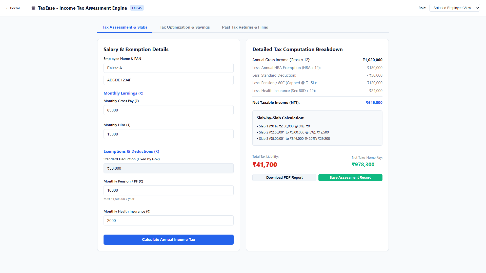
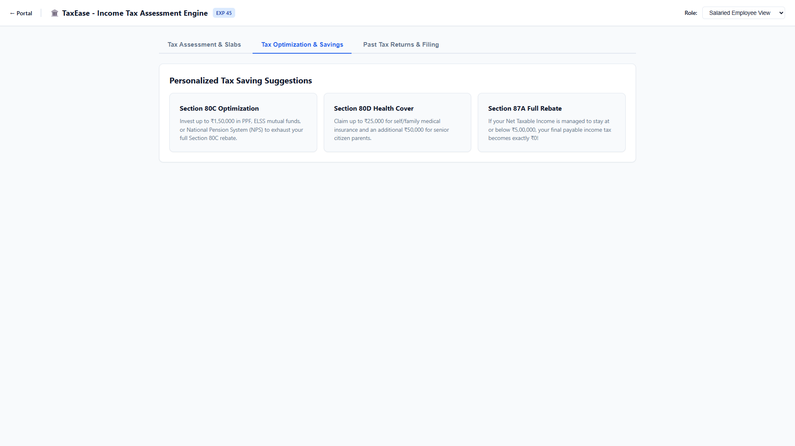
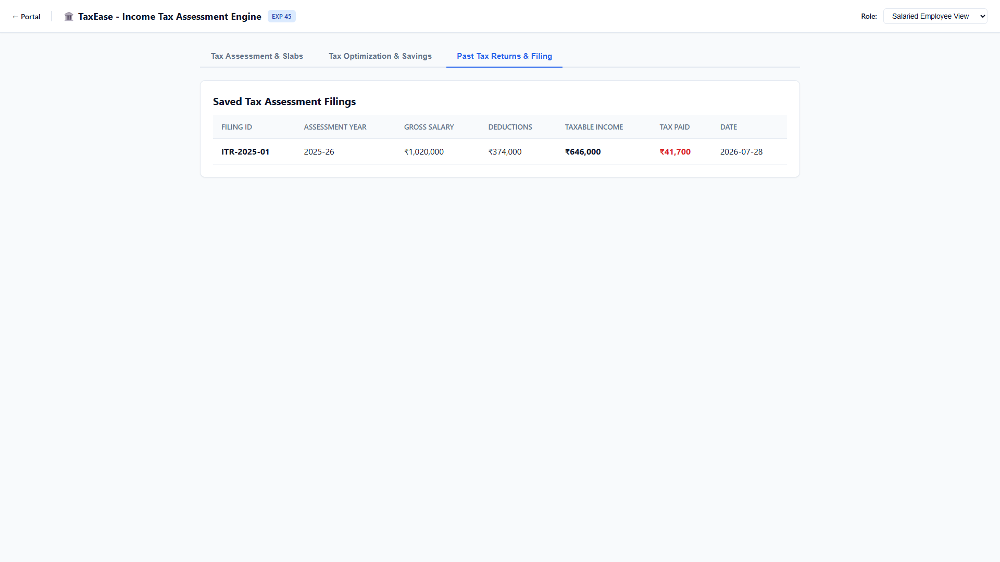
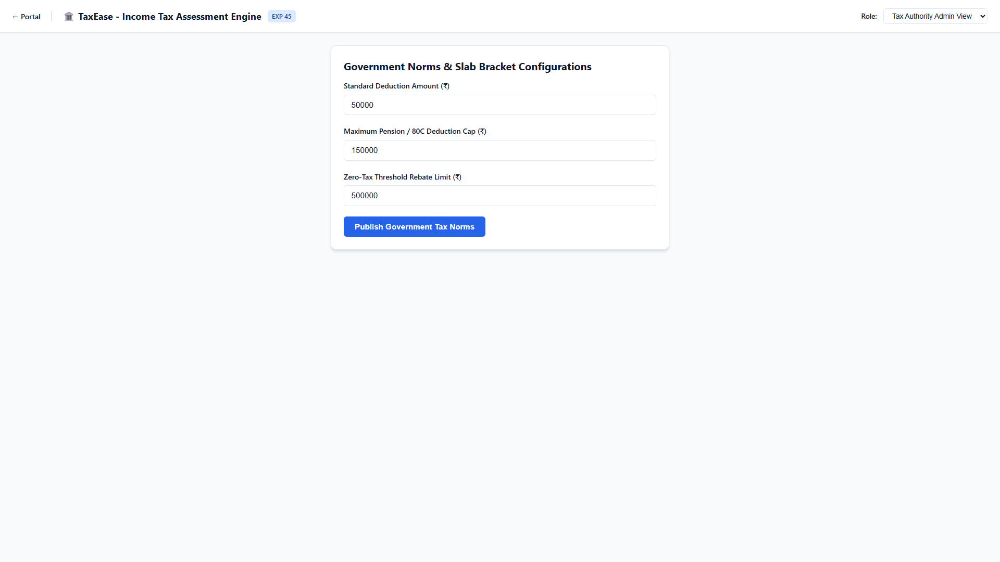

# Experiment 45: Income Tax Calculation Webpage

Output screenshots for all operational tabs and views (4 views in order).

| # | View Name | Screenshot Preview |
| :---: | :--- | :--- |
| 1 | **Salaried Employee View Tax Assessment Slabs** |  |
| 2 | **Salaried Employee View Tax Optimization Savings** |  |
| 3 | **Salaried Employee View Past Tax Returns Filing** |  |
| 4 | **Tax Authority Admin View Overview** |  |
