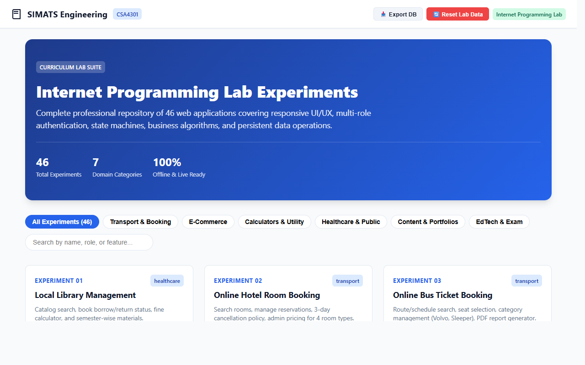

# Experiment Outputs

Output screenshots for each lab experiment in CSA4301.

| Experiment | Output |
| :--- | :--- |
| **Master Lab Portal** Interactive catalog and search for all experiments. |  |
| **01: Library Management** Book search, borrow/return status, and fine calculation. |  |
| **02: Hotel Room Booking** Room selection, pricing, and cancellation policy. |  |
| **03: Bus Ticket Booking** Seat selection layout and ticket generation. |  |
| **04: Train Reservation** PNR status, seat confirmation, and waitlist handling. |  |
| **05: Flight Reservation** Seat inventory, route selection, and boarding pass. |  |
| **06: Cake Ordering** Weight options, custom text, and delivery schedule. |  |
| **07: Beauty Parlour Appointment** Stylist selection, time slots, and booking confirmation. |  |
| **08: Hospital Appointment** Doctor specialization lookup and appointment booking. |  |
| **09: Electronics Store** Product catalog, shopping cart, and order checkout. |  |
| **10: Fashion Retailer** Apparel catalog, size selection, and wishlist. |  |
| **11: Real Estate Portal** Property filters, details view, and EMI calculator. |  |
| **12: Insurance Portal** Policy comparison, premium estimation, and claims form. |  |
| **13: Flower Delivery** Bouquet catalog, card messages, and delivery slots. |  |
| **14: Second-Hand Marketplace** Used goods listings and buyer-seller offers. |  |
| **15: Toll Payment System** Vehicle toll rates, pass renewal, and receipt generation. |  |
| **16: Grievance Redressal** Complaint filing, status tracking, and photo attachment. |  |
| **17: E-Voting System** Voter verification, ballot selection, and vote tallying. |  |
| **18: Agricultural Marketplace** Farmer produce listings, seeds, and fertilizer shop. |  |
| **19: Veterinary Telehealth** Pet symptom details, doctor consultations, and prescriptions. |  |
| **20: Vehicle Rental** Car selection, rental duration, and fare calculator. |  |
| **21: Job Recruitment Portal** Job openings, resume submission, and applicant tracking. |  |
| **22: Solid Waste Management** Bin status monitoring and collection route schedules. |  |
| **23: Blood Bank System** Donor records, blood group inventory, and request processing. |  |
| **24: Travel Agency** Holiday tour packages, daily itineraries, and booking vouchers. |  |
| **25: Road Breakdown Assistance** Emergency breakdown request and mechanic assignment. |  |
| **26: Police E-Challan System** Traffic violation logging, penalty calculation, and challan payment. |  |
| **27: Bus Pass Management** Student bus pass application, route selection, and pass renewal. |  |
| **28a: Artist Portfolio** Artwork gallery, exhibition dates, and contact page. |  |
| **28b: Event Landing Page** Conference schedule, speaker profiles, and registration form. |  |
| **30: Journal Publishing System** Paper submissions, reviewer assignments, and publication status. |  |
| **31: Dairy Farm Management** Milk procurement records, fat testing, and billing ledger. |  |
| **32: Laptop Sales & Service** Laptop models, repair service tracking, and invoices. |  |
| **33: Restaurant & Rooms** Dining table reservation, menu orders, and room booking. |  |
| **34: Tuition Centre Portal** Course batches, student enrollment, and progress reports. |  |
| **35: Smart Bus Pass System (v2)** Wallet balance, pass renewal, and bus route tracking. |  |
| **36a: Online Learning Platform** Course video lessons, assignments, and quizzes. |  |
| **36b: Online Bookstore** Book catalog, user reviews, shopping cart, and checkout. |  |
| **37: Personal Portfolio** Projects, work experience, technical skills, and resume. |  |
| **38: Restaurant Website** Food menu, table reservation, and chef specials. |  |
| **39: E-Commerce Store** Product catalog, cart, discount coupons, and orders. |  |
| **40: Travel Blog** Travel journals, interactive destination map, and comments. |  |
| **41: Recipe Book** Recipe instructions, serving size adjustment, and meal planner. |  |
| **42: Electricity Bill Payment** Unit consumption calculation, slab tariff rates, and late fees. |  |
| **43: Online Placement Exam** Multiple-choice test interface, timer, and score summary. |  |
| **44: Art Rating & Review** Artwork submissions, star ratings, and community reviews. |  |
| **45: Income Tax Calculator** Tax computation under standard deductions and income slabs. |  |
| **46: Phone Bill Payment** Postpaid bill lookup, overdue charges, and payment receipt. |  |
